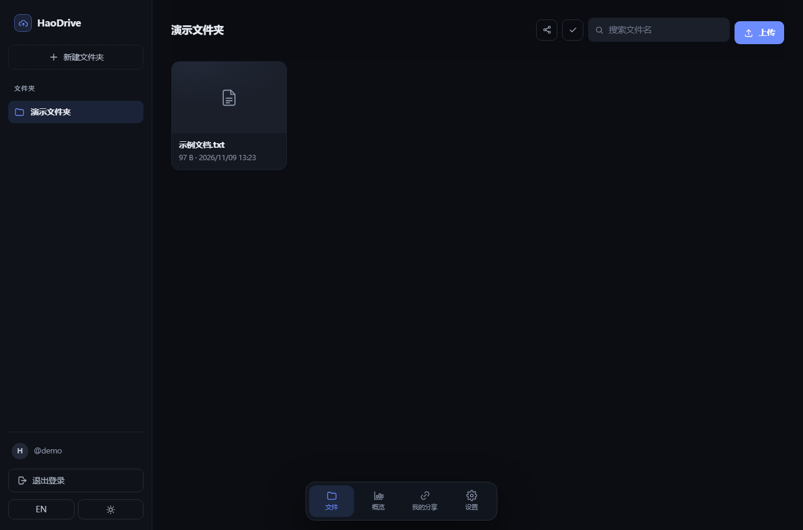
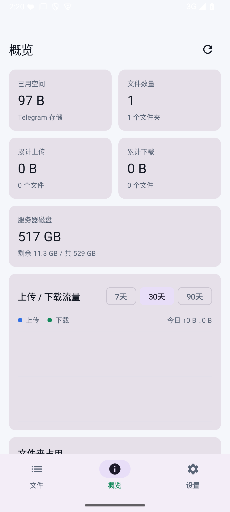
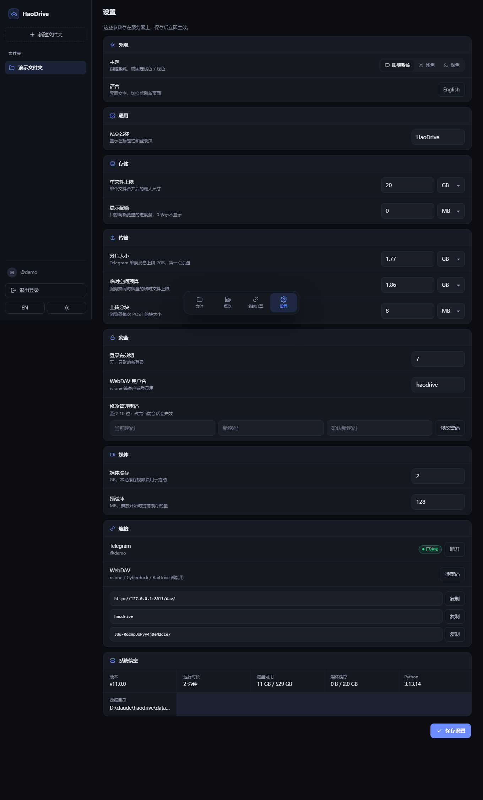

# HaoDrive · haodrive

A self-hosted cloud drive that uses a **private Telegram channel as its hard disk**. Run it on your own VPS, use it from any browser, and let Caddy issue HTTPS certificates automatically.

**English** · [中文](README.md)

The idea is the same as [Telegram-Drive](https://github.com/caamer20/Telegram-Drive): **one folder = one private broadcast channel, one file = one message in that channel**. Unlike the desktop client, HaoDrive is a web service, so any device with a browser can use it.

---

---

## ⚠️ Risk & Disclaimer

**This project is a personal hobby/research experiment** that explores using a private Telegram channel as a storage backend, plus browser-side multipart upload and cross-part playback. It is not a product and comes with no service guarantees.

- Using a third-party messaging API as a cloud drive **may violate Telegram's Terms of Service**. Bulk uploads, long-term storage of large files, and automated high-frequency calls can all be treated as abuse.
- Consequences include but are not limited to: **rate limits, feature restrictions, temporary freezes, or a permanent account ban**. Channels and files can disappear with the account.
- Laws on data storage, cross-border transfer and copyrighted content differ by jurisdiction. **Check your local law before using this.** Do not use it to store or distribute illegal or infringing content.
- This project is not affiliated with Telegram. The author is not responsible for account bans, data loss, service interruptions or any legal consequences.
- Suggestions: start with a test account, store only your own files, keep upload rates modest, and back up anything important elsewhere.

See [docs/RISK.md](docs/RISK.md).


## Features

- Web login with a single admin password and signed session cookies
- First-run wizard: api_id / api_hash / phone number / login code / two-step password
- Folder management: creating a folder creates a private Telegram channel (marked `[TD]`); existing desktop-created folders are detected
- File listing, search and pagination
- Drag-and-drop / multi-select upload; **the browser slices the file and uploads one part at a time**
- **Browser-side download merge** on Chromium browsers, with automatic fallback to direct streaming elsewhere
- HTTP Range support (resumable downloads, video seeking)
- Inline preview: images, video, audio, PDF, text
- Delete, move to another folder (forward + delete the original)
- Share links with optional expiry and optional password on a standalone public page
- **Chinese and English UI**, one click to switch; share pages follow the browser language
- **Overview dashboard**: storage used, optional quota meter, lifetime upload/download, 30-day traffic chart, per-folder usage; it lives in the bottom navigation boxes (Files / Overview / Shares / Settings), not in the left sidebar
- **Settings page in the browser**: site name, quota, part size, temp budget, upload chunk, session lifetime, media cache, prebuffer and the WebDAV user are all editable in the web UI; values are stored in SQLite and take effect immediately. The admin password can be rotated there too, no `.env` edit or restart
- **Light / dark theme**, following the OS by default; one consistent SVG icon set across files, navigation and settings
- Responsive UI that works on phones



## Android app (native)

`android/` is a native Android client written in **Kotlin + Jetpack Compose** that talks to the same HTTP API.



- Bottom navigation with three boxes: **Files / Overview / Settings** (overview is a bottom tab with two-column metric cards, not a left rail)
- Folder switching, search, upload through the same browser-style part API (with part progress)
- Image thumbnails; video/audio via Media3 with HTTP Range, parts stitched by the server
- Download to any folder, rename, delete
- Overview: used space, file count, lifetime upload/download, server disk, 7/30/90-day traffic chart, per-folder usage

Build (JDK 17 + Android SDK):

```bash
cd android
./gradlew assembleRelease
```

See [android/README.md](android/README.md).

## Architecture

```
Browser ──HTTPS──> Caddy ──> FastAPI (uvicorn)
                               ├─ Telethon (MTProto, your account)
                               ├─ SQLite  (settings/folder order/shares/traffic)
                               └─ Telegram private channels  ← files live here
```

- **Files never sit on the VPS disk.** The browser splits the file; the server receives one part → sends it to Telegram → deletes it → receives the next part.
- **Server temp storage stays strictly below 2GB** (default part size 1.9GB; `TMP_BUDGET_BYTES` is the hard cap). A 20GB file still uses only one part of temp space.
- **Browser memory stays at the current network block** (8MB), never the whole file.
- Your Telegram account is the storage account, a channel is a folder, and the same files are visible in the Telegram app.
- **Large files are split** at `TELEGRAM_PART_BYTES` into multiple Telegram messages, while the web UI treats them as one file for preview, seeking, download, sharing, moving and deleting. The 2GB per-message limit is imposed by Telegram.

### Upload flow

```
Pick a file
  ├─ GET /api/parts/limits          part size + 8MB network chunk
  ├─ file.slice() in the browser    never loads the whole file
  ├─ POST /api/parts                declare part N, server creates a temp file
  ├─ PUT /api/uploads/{id}?offset   8MB at a time, resumable
  ├─ POST /api/uploads/{id}/complete send this part to Telegram
  ├─ Poll the job until it really finished and the temp file was deleted
  └─ Next part
All parts done → server registers one logical file → the list shows one file
```

After a reload, selecting the same file skips finished parts and resumes an unfinished part from its last offset.

### Download flow

```
Click download
  ├─ GET .../manifest               offsets and sizes for every part
  ├─ Chrome/Edge: showSaveFilePicker
  ├─ One Range request per part     server reads only that Telegram slice
  ├─ Read and write the local file  no Blob accumulation, no memory blowup
  └─ Close after the last part      one complete file
```

Firefox, Safari and some Android browsers do not expose the File System Access API, so they fall back to the server-side streaming download (which also never spools the whole file). Batch downloads always use direct streaming because browsers only allow one save dialog per user gesture.

---

## Deploy with Docker in five minutes

### 1. Domain

Create an **A record** pointing at the VPS public IP, e.g. `drive.example.com`.

> If you use Cloudflare, turn off the orange cloud (DNS only) while Caddy obtains the certificate, then turn it back on.

### 2. Install Docker

```bash
curl -fsSL https://get.docker.com | sh
```

### 3. Upload and configure

Copy this directory to the VPS, e.g. `/opt/haodrive`, then:

```bash
cd /opt/haodrive
cp .env.example .env
nano .env
```

Change at least:

```env
DOMAIN=drive.example.com
ADMIN_PASSWORD=use-a-long-password
```

If the VPS cannot reach Telegram directly, add a proxy:

```env
PROXY=socks5://127.0.0.1:1080
```

### 4. Start

```bash
docker compose up -d --build
```

Caddy requests the certificate on the first start. Wait 10–30 seconds:

```bash
docker compose logs -f caddy
```

When you see `certificate obtained successfully`, it is ready.

### 5. Connect Telegram

Open `https://your-domain`:

1. Log in with `ADMIN_PASSWORD`.
2. Enter **api_id / api_hash** (create your own app at [my.telegram.org](https://my.telegram.org) → API development tools) and your phone number with the country code, e.g. `+8613800000000`.
3. Enter the code (it may arrive in the Telegram app instead of SMS).
4. Enter the two-step password if you have one.
5. Click **New folder** — this creates a private Telegram channel; now you can upload files.

---

## Common operations

```bash
docker compose logs -f app      # backend logs
docker compose restart app      # restart
docker compose down             # stop
docker compose up -d --build    # rebuild after updating code
```

All state lives under `./data`:

| File | Contents |
|---|---|
| `data/haodrive.db` | Settings, folder order, share links, upload groups, traffic/storage stats; **the Telegram session is encrypted here too** |
| `data/secret.key` | Encryption key + session signing key |
| `data/tmp/` | Upload staging, at most one part at a time, cleaned automatically |
| `data/cache/` | Thumbnails + media block cache |

**Back up the whole `data/` directory.** Without `secret.key` the session and encrypted settings cannot be decrypted, and you will have to sign in to Telegram again.

### Upgrading from seagulldrive

If `data/seagulldrive.db` exists and `data/haodrive.db` does not, the database and its `-wal/-shm` sidecars are renamed automatically on startup. Settings, the Telegram session and share links are preserved. Old login/share cookies expire — sign in again; interrupted uploads must be reselected to resume.

---

## UI and statistics

### Bilingual UI

- Language buttons (`EN` / `中文`) on the login card and in the sidebar.
- The choice is stored in `localStorage.haodrive_lang` and in the `hd_lang` cookie for share pages.
- The default follows the browser language. Error messages, upload states and share pages are translated as well.

### Overview

Click **Overview** in the sidebar:

- **Used storage**: sum of logical file sizes, broken down by folder; set `STORAGE_QUOTA_BYTES` to show a quota meter.
- **Total uploaded / downloaded**: actual transferred bytes, including retries and Range slices.
- **Uploaded/downloaded today**.
- **Traffic chart**: last 7 / 30 / 90 days, stacked upload (blue) + download (orange) bars, hover for details, with an expandable data table.
- **Storage by folder**: horizontal bars sorted by size.
- Counters live in SQLite and survive restarts. The dashboard refreshes every 10 seconds; the refresh button rescans Telegram to reconcile storage.

> Telegram has no real quota. `STORAGE_QUOTA_BYTES` is only a display denominator and does not block uploads; the actual limit is `MAX_UPLOAD_BYTES`.

---

### Settings

Open it from the bottom of the sidebar or the bottom navigation. Values live in the SQLite `settings` table and **override the same-named environment variables**, taking effect on the next request:

| Item | Env var | Notes |
|---|---|---|
| Site name | `SITE_NAME` | Title bar, sidebar, login page |
| Max file size | `MAX_UPLOAD_BYTES` | After parts are merged |
| Display quota | `STORAGE_QUOTA_BYTES` | Dashboard bar only; 0 hides it |
| Part size | `TELEGRAM_PART_BYTES` | 1.9GB default; Telegram caps at 2GB |
| Temp budget | `TMP_BUDGET_BYTES` | Must be at least the part size |
| Upload chunk | `UPLOAD_CHUNK` | Bytes per browser POST |
| Session lifetime | `SESSION_DAYS` | Days; applies to new logins |
| Media cache / prebuffer | `MEDIA_CACHE_GB` / `PREBUFFER_MB` | Video seeking; resizing the cache does not interrupt playback |
| WebDAV user | `WEBDAV_USER` | Rotate the password from the settings page |

Changing the admin password signs out the current session. `ADMIN_PASSWORD` in `.env` is only the bootstrap credential; once rotated, the scrypt hash in the database is authoritative and the old env value no longer works.

If you forget the password set in the UI, delete the stored hash and the `.env` `ADMIN_PASSWORD` takes over again:

```bash
cd /opt/haodrive && .venv/bin/python3 -c 'import sqlite3; c=sqlite3.connect("data/haodrive.db"); c.execute("DELETE FROM settings WHERE key=?", ("admin_password_hash",)); c.commit()' && systemctl restart haodrive
```



## FAQ

**502 or no certificate**
- The A record has not propagated, or ports 80/443 are occupied (stop Nginx/Apache first).
- Cloudflare proxy mode is still on — turn it off.

**`API_ID_PUBLISHED_FLOOD` on login**
- You are using a leaked api_id. Create your own app at my.telegram.org.

**`FLOOD_WAIT`**
- Telegram is rate limiting you. Wait the indicated time. Uploads are serial; do not throw hundreds of files at it at once.

**Upload stuck at 0% / “Sending to Telegram…”**
- The VPS cannot reach Telegram. Configure `PROXY` and restart.
- Check `docker compose logs -f app`.

**“Server temp space is full (2GB cap)”**
- The previous part is still being sent to Telegram; the server waits for it to finish and delete its temp file.
- A failed job may have left a temp file; click **Cancel** on the upload row or wait 24 hours for cleanup.
- You can raise `TMP_BUDGET_BYTES`, but the VPS disk must keep up.

**Files over 2GB**
- The web client splits automatically (default 1.9GB per part, configurable via `TELEGRAM_PART_BYTES`); the server still uses only one part of temp space.
- In the Telegram app you will see parts named `xxx.part001`; this is expected.
- The logical file limit is `MAX_UPLOAD_BYTES` (default 20GB).
- The legacy multipart/resumable endpoints remain for scripts but are capped at 2GB per file. Use the web UI or the `/api/parts` protocol for larger files.

**No save dialog on download**
- Only desktop Chrome/Edge support browser-side merging. Other browsers fall back to direct streaming.
- Direct streaming still produces one complete file; the server concatenates the parts while sending.
- Batch downloads always use direct streaming because browsers do not allow multiple save dialogs from one gesture.

**How much disk does browser merging need?**
- The browser may use temporary space in the destination directory. Keep at least the file size free. This is disk space, not RAM.

**Old folders created by the desktop Telegram-Drive**
- They are detected by the `[TD]` title marker or the `[telegram-drive-folder]` channel description. They are recorded locally, so they stay in the list even if the marker is later removed.

---

## Local demo (no Telegram)

```bash
python -m venv .venv
.venv/bin/pip install -r requirements.txt
DEMO_MODE=1 ADMIN_PASSWORD=demo uvicorn app.main:app --port 8010
```

Windows:

```powershell
.venv\Scripts\python.exe -m uvicorn app.main:app --port 8010
```

Open http://127.0.0.1:8010 and use password `demo`. Demo mode uses `data/demo/` as a fake drive, which is enough to explore the UI and dashboard.

To see the multi-part flow with small files:

```bash
DEMO_MODE=1 ADMIN_PASSWORD=demo TELEGRAM_PART_BYTES=8 uvicorn app.main:app --port 8010
```

Upload a few dozen bytes; the list shows “N parts”, and downloading exercises the browser-side merge path.

---

## Security

- Only port 8000 is exposed to Caddy; the app itself is not public.
- Passwords are checked with scrypt; login is limited to 8 attempts per 5 minutes.
- Session cookie: HttpOnly + SameSite=Lax, Secure automatically under HTTPS.
- Every mutating request requires a custom header, so cross-site forms cannot forge writes.
- Share tokens are 128-bit random, with optional password and expiry.
- Upload sessions use a per-session lock; temp files are mode 0600.
- WebDAV writes honor `If` lock tokens and return 423 on conflict.
- **Warning**: if the server is compromised, your Telegram account session is compromised too. Secure the VPS (SSH keys, firewall, updates).

## Layout

```
app/
  main.py          FastAPI routes (parts / download / stats / shares)
  parts.py         Client-part bookkeeping + rolling server spool
  traffic.py       Traffic counter buffer
  tg_backend.py    Telegram (Telethon) backend
  demo_backend.py  Local-directory demo backend
  db.py            SQLite (includes seagulldrive → haodrive migration)
  security.py      Password/session/rate limiting
  i18n.py          Server-side share-page translations
  config.py        Environment configuration
  static/
    i18n.js        Chinese/English strings
    app.js         Frontend (plain JS, no build step)
    index.html
    style.css
    sw.js
    manifest.webmanifest
Dockerfile
docker-compose.yml
Caddyfile
.env.example
README.md
```

---

## WebDAV

The **WebDAV** dialog in the sidebar shows the URL, username and generated password (rotatable).

- URL: `https://your-domain/<secret-path>/dav/` (same port as the site; 24443 in the systemd example, 443 with Docker)
- Methods: `PROPFIND / GET / HEAD / PUT / DELETE / MKCOL / MOVE / COPY / LOCK / UNLOCK`
- WebDAV uploads also use the rolling spool: the stream is rotated into 1.9GB parts and sent to Telegram one at a time, never written whole to disk.
- Works with `rclone`, Cyberduck, RaiDrive and macOS Finder. Windows Explorer only mounts on port 443; use rclone for non-standard ports:

```bash
rclone config create haodrive webdav url https://your-domain:24443/<secret-path>/dav/ vendor other user haodrive pass <password>
rclone ls haodrive:
```

## Resumable uploads

The browser uploads 8MB network chunks; the server validates offsets and persists progress:

- Per-part progress is stored in SQLite, so a restart does not lose it
- The browser remembers the `group_key`; after a reload or network drop, selecting the same file skips completed parts and resumes from the current offset
- Each chunk retries 3 times; a failed part keeps its state and offers **Retry** / **Cancel**
- Cancelling a whole group deletes the unfinished part messages already sent to Telegram, leaving no junk

## Video playback

- 2MB media blocks cached on the server (`MEDIA_CACHE_GB`, default 2GB), served from local disk on a hit
- Three blocks are prefetched during playback, so seeking does not hit Telegram every time
- HTTP Range, `If-Range` and `If-None-Match` are supported; unsatisfiable ranges return 416
- Temp uploads and media cache are separate budgets: temp <2GB, cache 2GB by default

## Speed and stutter

- **Slow downloads**: the browser↔VPS path is one TCP connection. On long-haul links with high RTT, cubic congestion control caps a single connection near 2MB/s (four connections reached 6.6MB/s from the same host, so the VPS uplink is not the bottleneck). Run once as root on the VPS:

  ```bash
  bash tools/optimize-vps.sh
  ```

  It enables BBR + fq and enlarges TCP buffers. Established connections must reconnect to benefit.

- **Video stutter**: players request ranges; when a video/audio file opens, the server warms `PREBUFFER_MB` (default 128MB) in the background, so later seeks read from local disk.
- These reduce waiting and duplicate downloads; they cannot exceed the VPS uplink.

## Tests

```bash
pip install -r requirements-dev.txt
python -m pytest -q
```

Coverage includes session/share token isolation, Range parsing, legacy chunk upload, client part grouping/hiding/manifest, cross-part Range reads, cancel cleanup, storage/traffic counters, share passwords, the full WebDAV flow, media cache hit/eviction, and the bilingual HTML shell. CI is in `.github/workflows/ci.yml`.

## Operations

```bash
systemctl status haodrive caddy
journalctl -u haodrive -f
```

- `/healthz`: 200 while the process is alive
- `/readyz`: database, disk free, Telegram state, cache; returns 503 below 200MB free
- `GET /api/status` (auth): cache hit stats, disk, job count
- `GET /api/stats` (auth): storage, traffic, daily series
- `POST /api/stats/refresh` (auth): rescan Telegram and reconcile storage
- Logs include method/path/status/duration; share paths are redacted as `/s/***`

## License

MIT — see [LICENSE](LICENSE).
