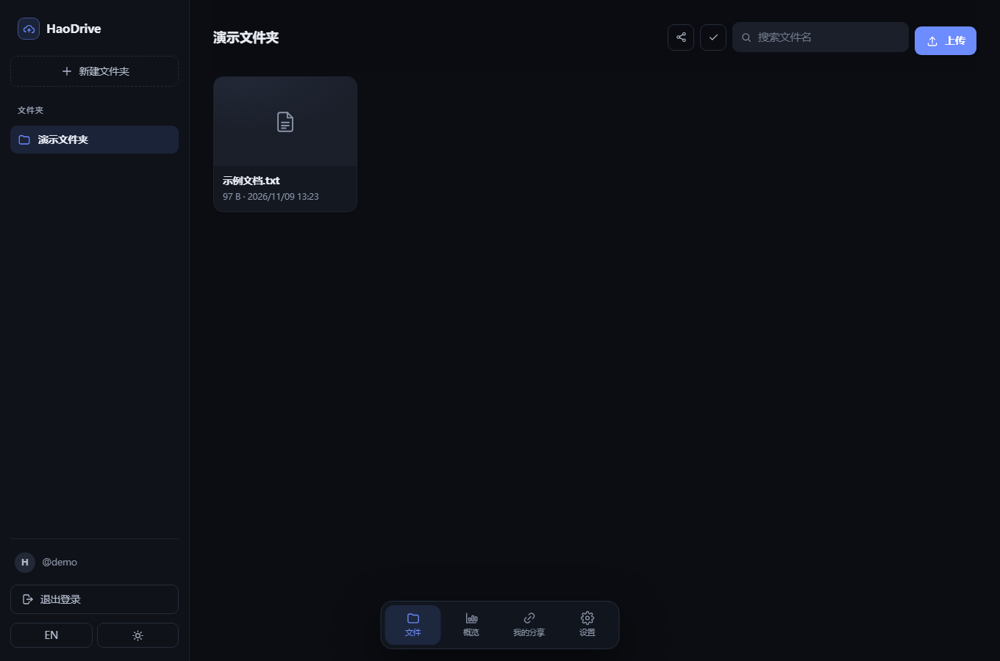
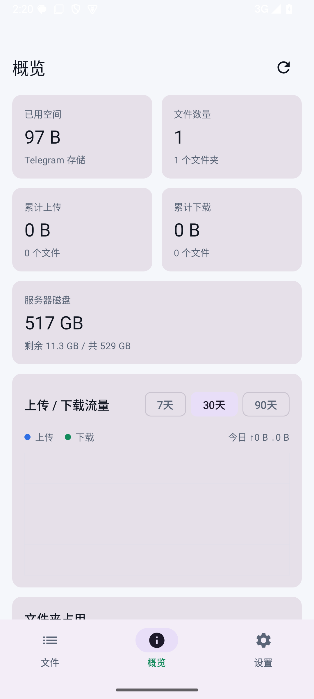
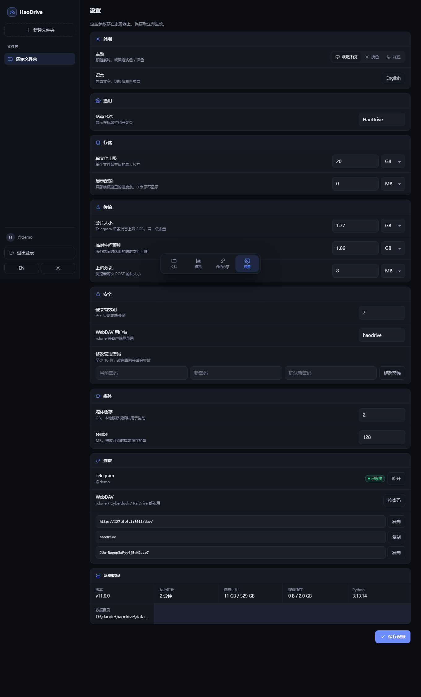

# HaoDrive · haodrive

把 **Telegram 私有频道当硬盘**的自托管云盘。部署在你自己的 VPS 上，浏览器直接用，Caddy 自动签 HTTPS。

[English](README.en.md) · **中文**

思路和 [Telegram-Drive](https://github.com/caamer20/Telegram-Drive) 一样：**一个文件夹 = 一个私有广播频道，一个文件 = 频道里的一条消息**。但它不是桌面客户端，而是一个 Web 服务，任何设备打开浏览器就能用。

---

---

## ⚠️ 风险与免责声明

**本项目只是个人兴趣爱好研究**，用于验证「把 Telegram 私有频道当存储后端」以及浏览器端分片上传、跨分片播放的可行性。它不是产品，不提供任何服务保证。

- 用第三方即时通讯服务的 API 当网盘，**可能违反 Telegram 的服务条款（Terms of Service）**。批量上传、长期存储大文件、自动化高频调用都可能被判定为滥用。
- 后果包括但不限于：**账号被限流、功能受限、临时冻结，甚至永久封禁**；频道和文件也可能一起没掉。
- 不同国家和地区对数据存储、跨境传输和版权内容的法规不一样，**使用前请自行确认当地法律**。不要用它存储或传播违法、侵权内容。
- 本项目与 Telegram 官方没有任何关系。作者不对封号、数据丢失、服务中断或任何法律后果负责。
- 建议：用测试账号先跑，只存自己的文件，控制上传频率，重要数据另做备份。

详见 [docs/RISK.md](docs/RISK.md)。


## 功能

- 网页登录（单管理员密码），会话签名 Cookie
- 首次使用向导：api_id / api_hash / 手机号 / 验证码 / 两步验证
- 文件夹管理：新建 = 在 Telegram 建私有频道（标题带 `[TD]`），自动识别桌面版建的旧频道
- 文件列表、搜索、分页
- 拖拽 / 多选上传，**浏览器切片、一片一片传**，服务端同一时刻只落一片
- 下载支持 **浏览器分片合并**（Chromium 系），不支持的环境自动回退直连下载
- 下载支持 HTTP Range（断点续传、视频拖动进度条）
- 在线预览：图片、视频、音频、PDF、文本
- 删除、移动到其它文件夹（转发+删除原消息）
- 分享链接：可选有效期、可选访问密码，独立公开页面
- **中英文界面**，右上角 / 侧边栏一键切换；分享页也会跟随浏览器语言
- **概览仪表盘**：已用空间、配额进度、累计上传/下载、30 天流量图、按文件夹占用；入口在页面底部导航方框（文件 / 概览 / 我的分享 / 设置），不占左侧栏
- **网页设置页**：站点名称、配额、分片大小、临时空间预算、上传分块、登录有效期、媒体缓存、预缓冲、WebDAV 用户名都能在网页里改，存进 SQLite 并立即生效，不用改 `.env` 重启；管理密码也能在网页里换
- **浅色 / 深色主题**，默认跟随系统；文件图标、导航和设置页均为统一的一套 SVG 图标
- 响应式 UI，手机能用



## 安卓客户端（原生）

`android/` 是用 **Kotlin + Jetpack Compose** 写的原生安卓客户端，直接调用同一套 HTTP API。



- 底部导航三个方框：**文件 / 概览 / 设置**（概览不是左侧导航栏，指标以两列卡片展示）
- 文件夹切换、搜索、上传（走浏览器同款分片接口，带片数进度）
- 图片缩略图、视频/音频 Media3 播放（HTTP Range，跨分片由服务端拼接）
- 下载到任意目录、重命名、删除
- 概览：已用空间、文件数、累计上传/下载、服务器磁盘、7/30/90 天流量图、文件夹占用

构建（需要 JDK 17 + Android SDK）：

```bash
cd android
./gradlew assembleRelease
```

详见 [android/README.md](android/README.md)。

> 上面这个是**依赖服务端**的安卓客户端。另有一份独立客户端计划——Windows exe / Linux 二进制 / Android apk，直连 Telegram、不依赖服务器，映射规则与服务端一致：见 **[docs/CLIENTS.md](docs/CLIENTS.md)**。

## 架构

```
浏览器 ──HTTPS──> Caddy ──> FastAPI (uvicorn)
                              ├─ Telethon (MTProto, 你的账号)
                              ├─ SQLite  (设置/文件夹顺序/分享链接/流量统计)
                              └─ Telegram 私有频道  ← 文件真正存在这里
```

- **文件不落在 VPS 磁盘上**。上传时浏览器把文件切成片，服务端收一片 → 发到 Telegram → 删掉 → 再收下一片。
- **服务端临时盘严格低于 2GB**（默认每片 1.9GB，`TMP_BUDGET_BYTES` 是硬上限）。20GB 的文件也只占一片的空间。
- **浏览器内存只占当前网络块**（8MB 一片），不会把整个文件读进内存。
- 你的 Telegram 账号就是存储账号，频道就是文件夹，手机上用 Telegram 也能直接看到这些文件。
- **大文件分片**：超过 `TELEGRAM_PART_BYTES` 的文件会拆成多条 Telegram 消息上传，网页里仍然显示成一个文件，播放、拖动、下载、分享、移动、删除都按整体处理。单条消息的 2GB 是 Telegram 的硬限制。

### 上传流程

```
选文件
  ├─ GET /api/parts/limits          拿每片大小 / 8MB 网络块大小
  ├─ 浏览器 file.slice() 切片       不读进内存
  ├─ POST /api/parts                声明第 N 片；大分片当场开流式会话
  ├─ PUT  /api/uploads/{id}?offset 8MB 一块传，服务端边收边发往 Telegram
  ├─ POST /api/uploads/{id}/complete 收尾 + 发消息（此时文件已经在 TG 上）
  ├─ 轮询 job，等这片真正发完
  └─ 下一片
所有片完成 → 服务端登记逻辑文件 → 列表里是一个文件
```

大于 10MB 的分片不再落盘：HTTP 体一到就被切成 512KB 的 Telegram 分块，
由 4 个工作线程并发 `SaveBigFilePart`。浏览器和 Telegram 同时在干活，总耗时从
`浏览器 + Telegram` 变成 `max(浏览器, Telegram)`；内存缓冲有界（默认 32MB），
缓冲满了就自然卡住浏览器，不需要额外的限流也能压住磁盘占用。

刷新页面后重新选同一个文件，已完成的片会跳过，未完成的片从上次 offset 继续。

### 下载流程

```
点下载
  ├─ GET .../manifest               拿到每片的 offset / size
  ├─ Chrome/Edge：showSaveFilePicker 选保存位置
  ├─ 对每片发 Range 请求            服务端只读 Telegram 对应片段
  ├─ 一边读一边写本地文件           不攒 Blob，不占内存
  └─ 全部写完 close，得到一个完整文件
```

Firefox / Safari / 部分安卓浏览器没有 File System Access API，会自动回退到服务端边读边发的直连下载（同样不落整份盘）。批量下载始终走直连，避免浏览器拦截保存对话框。

---

## 部署方式一览

不一定要用 Docker。五种方式按环境挑，详细步骤都在 **[docs/DEPLOY.md](docs/DEPLOY.md)**：

| 方式 | 适合谁 | 说明 |
|---|---|---|
| **systemd + Caddy** | 有 VPS、有域名 | 推荐；线上就是这套，`deploy/install.sh` 一键装 |
| **systemd + nginx** | 已经用 nginx 的人 | `deploy/nginx/haodrive.conf` 直接抄 |
| **公网 IP 都没有** | 家里宽带 / NAS | Cloudflare Tunnel、frp，本机 Caddy 保留密钥路径 |
| **Windows 本机** | 想先跑起来看看 | `deploy\windows\run-haodrive.ps1` |
| **Docker** | 不想碰 Python | 下面这一节 |

> 反代必须关掉请求体缓冲（nginx 的 `proxy_request_buffering off`），
> 否则 v11.1 的流式上传会退化成"先收完再转发"。

---

## 部署（Docker，五分钟）

### 1. 域名

在域名服务商加一条 **A 记录**，指向 VPS 公网 IP，例如 `drive.example.com`。

> 如果套了 Cloudflare，部署时先关掉橙色云朵（仅 DNS），等 Caddy 签完证书再开。

### 2. 装 Docker

```bash
curl -fsSL https://get.docker.com | sh
```

（国内机器慢的话用阿里云镜像源。）

### 3. 上传代码并配置

把本目录传到 VPS，例如 `/opt/haodrive`，然后：

```bash
cd /opt/haodrive
cp .env.example .env
nano .env
```

必改两项：

```env
DOMAIN=drive.example.com
ADMIN_PASSWORD=换成一个长密码
```

如果这台 VPS 连不上 Telegram（比如国内机器），加代理：

```env
PROXY=socks5://127.0.0.1:1080
```

### 4. 启动

```bash
docker compose up -d --build
```

第一次启动 Caddy 会去申请证书，等 10~30 秒：

```bash
docker compose logs -f caddy
```

看到 `certificate obtained successfully` 就成了。

### 5. 连接 Telegram

打开 `https://你的域名`：

1. 输入 `ADMIN_PASSWORD` 登录。
2. 按向导填 **api_id / api_hash**（去 [my.telegram.org](https://my.telegram.org) → API development tools 自己建一个），再填手机号（带国家码，如 `+8613800000000`）。
3. 收验证码（可能发在 Telegram 客户端里而不是短信），提交。
4. 有两步验证就再输一次密码。
5. 进主界面后点「新建文件夹」——它会在 Telegram 里建一个私有频道，然后就能传文件了。

---

## 常用操作

```bash
docker compose logs -f app      # 看后端日志
docker compose restart app      # 重启
docker compose down             # 停止
docker compose up -d --build    # 更新代码后重建
```

数据都在 `./data`：

| 文件 | 内容 |
|---|---|
| `data/haodrive.db` | 设置、文件夹顺序、分享链接、上传分组、流量/存储统计；**Telegram 会话也加密存在这里** |
| `data/secret.key` | 加密密钥 + 会话签名密钥 |
| `data/tmp/` | 上传中转，同一时刻最多一片，会自动清理 |
| `data/cache/` | 缩略图 + 媒体块缓存 |

**备份就备份整个 `data/` 目录**。丢了 `secret.key`，数据库里的会话和密钥就解不开了，需要重新登录 Telegram。

### 从 seagulldrive 升级

启动时如果发现旧的 `data/seagulldrive.db` 而 `data/haodrive.db` 不存在，会自动把数据库和 `-wal/-shm` 一起改名。设置、Telegram 会话、分享链接都会保留。改名后旧的登录 Cookie / 分享解锁 Cookie 会失效，重新输一次密码即可；进行中的上传需要重新选文件续传。

---

## 界面与统计

### 双语

- 登录页右上角、侧边栏底部都有语言按钮（`EN` / `中文`）。
- 选择存在 `localStorage.haodrive_lang`，同时写 `hd_lang` Cookie 给分享页用。
- 默认跟浏览器语言；英文环境下错误提示、上传状态、分享页也会翻译。

### 概览

侧边栏点「概览」：

- **已用空间**：所有逻辑文件大小之和，按文件夹拆分；配置 `STORAGE_QUOTA_BYTES` 后显示配额进度条。
- **累计上传 / 累计下载**：按实际传输字节统计，重传、Range 片段都算。
- **今日上传 / 今日下载**。
- **流量图**：最近 7 / 30 / 90 天，上传（蓝）和下载（橙）堆叠柱状图，悬停看当天明细，下面有可展开的数据表。
- **文件夹占用**：横向条形图，按大小排序。
- 统计存在 SQLite，重启不丢；每 10 秒自动刷新，右上角可手动重扫 Telegram 校准存储数字。

> Telegram 本身没有配额概念。`STORAGE_QUOTA_BYTES` 只是仪表盘的分母，不参与上传拦截；真正的上传上限是 `MAX_UPLOAD_BYTES`。

---

### 设置

侧边栏底部或底部导航「设置」进入。这些值存在 SQLite 的 `settings` 表里，**优先于 `.env` 里的同名环境变量**，保存后下一个请求就生效：

| 项目 | 环境变量 | 说明 |
|---|---|---|
| 站点名称 | `SITE_NAME` | 标题栏、侧栏、登录页 |
| 单文件上限 | `MAX_UPLOAD_BYTES` | 合并后的最大尺寸 |
| 显示配额 | `STORAGE_QUOTA_BYTES` | 只影响概览进度条，0 = 不显示 |
| 分片大小 | `TELEGRAM_PART_BYTES` | 默认 1.9GB，Telegram 硬上限 2GB |
| 临时空间预算 | `TMP_BUDGET_BYTES` | 必须 ≥ 分片大小 |
| 上传分块 | `UPLOAD_CHUNK` | 浏览器每次 POST 的块 |
| 登录有效期 | `SESSION_DAYS` | 天，只影响新登录 |
| 媒体缓存 / 预缓冲 | `MEDIA_CACHE_GB` / `PREBUFFER_MB` | 视频拖动用；改缓存上限不会中断正在播放的视频 |
| WebDAV 用户名 | `WEBDAV_USER` | 密码在设置页里「换密码」 |

管理密码改完后会作废当前会话，需要重新登录。`.env` 里的 `ADMIN_PASSWORD` 只是首次启动的引导密码，改过之后以数据库里的哈希为准（scrypt），`.env` 里那个旧值不再能登录。

忘记网页里设的新密码时，删掉库里那条哈希就会回退到 `.env` 的 `ADMIN_PASSWORD`：

```bash
cd /opt/haodrive && .venv/bin/python3 -c 'import sqlite3; c=sqlite3.connect("data/haodrive.db"); c.execute("DELETE FROM settings WHERE key=?", ("admin_password_hash",)); c.commit()' && systemctl restart haodrive
```



## 常见问题

**打开页面 502 / 证书没签下来**
- 域名 A 记录没生效，或者 80/443 被别的服务占了（Nginx/Apache 先停掉）。
- Cloudflare 开了代理模式，先关。

**登录时报 `API_ID_PUBLISHED_FLOOD`**
- 你用的是网上抄来的 api_id。去 my.telegram.org 新建一个自己的应用。

**`FLOOD_WAIT`**
- Telegram 限流，等提示的时间再操作。上传是串行的，别一次塞几百个文件。

**上传卡在 0% / 一直“上传到 Telegram…”**
- VPS 到 Telegram 不通。配 `PROXY`，重启后再试。
- 看 `docker compose logs -f app` 里的报错。

**提示“服务器临时空间不足（2GB 上限）”**
- 上一片还在发往 Telegram，服务端要等它发完删掉临时文件才收下一片。
- 如果有失败任务留下的临时文件，点上传行的「取消」或等 24 小时自动清理。
- 想放宽可以调 `TMP_BUDGET_BYTES`，但 VPS 盘要跟得上。

**文件超过 2GB**
- 网页端会自动切片（每片默认 1.9GB，`TELEGRAM_PART_BYTES` 可调），服务端仍只占一片。
- 直接在 Telegram 客户端里看会看到 `xxx.part001` 这样的分片，属于正常现象。
- 总大小上限由 `MAX_UPLOAD_BYTES` 控制（默认 20GB）。
- 旧版 multipart / 断点接口仍保留给脚本，但单文件限制在 2GB 内；超过请用网页端或 `/api/parts` 协议。

**下载没有弹出保存位置**
- 只有 Chrome / Edge（桌面）支持边下边合并。其它浏览器会自动回退到直连下载。
- 直连下载同样是一个完整文件，只是由服务端拼接后流式发送。
- 批量下载固定走直连，因为浏览器不允许连续弹多个保存对话框。

**浏览器端合并要多少磁盘**
- 写文件时浏览器可能需要同目录的临时空间，最好留出文件大小以上的空余；这不是内存占用问题。

**想用桌面版 Telegram-Drive 建的旧文件夹**
- 会自动识别（标题里的 `[TD]` 或频道简介里的 `[telegram-drive-folder]` 标记）。找到的旧频道会写进本地数据库，之后即使标记丢了也不会从列表里消失。

---

## 本地试跑（不连 Telegram）

```bash
python -m venv .venv
.venv/bin/pip install -r requirements.txt
DEMO_MODE=1 ADMIN_PASSWORD=demo uvicorn app.main:app --port 8010
```

Windows：

```powershell
.venv\Scripts\python.exe -m uvicorn app.main:app --port 8010
```

打开 http://127.0.0.1:8010 ，密码 `demo`。演示模式用 `data/demo/` 目录假装是云盘，适合先看界面和统计。

想看分片流程可以把每片调小：

```bash
DEMO_MODE=1 ADMIN_PASSWORD=demo TELEGRAM_PART_BYTES=8 uvicorn app.main:app --port 8010
```

传一个几十字节的文件，列表会显示“N 分片”，下载时就能看到浏览器按片拉取再合并。

---

## 安全说明

- 只暴露 8000 给 Caddy，应用本身不对公网开端口。
- 登录密码用 scrypt 哈希比对，登录限流 8 次 / 5 分钟。
- 会话 Cookie：HttpOnly + SameSite=Lax，HTTPS 下自动 Secure。
- 所有写接口要求自定义请求头（跨站表单伪造不了）。
- 分享链接 token 128 位随机，可选密码 + 过期时间。
- 上传分片有会话锁，避免并发写坏文件；临时文件 0600。
- WebDAV 写操作会检查 `If` 锁令牌，冲突返回 423。
- **注意**：这台服务器一旦被拿下，等于你的 Telegram 账号会话被拿下。VPS 安全自己上点心（SSH 密钥登录、防火墙、及时更新）。

## 目录结构

```
app/
  main.py          FastAPI 路由（分片上传 / 下载 / 统计 / 分享）
  parts.py         客户端分片登记 + 服务端滚动切片
  traffic.py       流量计数缓冲
  tg_backend.py    Telegram（Telethon）后端
  demo_backend.py  本地目录模拟后端
  db.py            SQLite（含 seagulldrive → haodrive 迁移）
  security.py      密码/会话/限流
  i18n.py          分享页服务端翻译
  config.py        环境变量
  static/
    i18n.js        中英文文案
    app.js         前端（原生 JS，无构建）
    index.html
    style.css
    sw.js
    manifest.webmanifest
Dockerfile
docker-compose.yml
Caddyfile
.env.example
README.en.md
```

---

## WebDAV 挂载

页面左下角「WebDAV 挂载」里能看到地址、用户名和密码（密码自动生成，可一键更换）。

- 地址：`https://你的域名/<随机路径>/dav/`（端口跟站点一致；本文档的 VPS 部署用 24443，Docker 部署默认 443）
- 支持 `PROPFIND / GET / HEAD / PUT / DELETE / MKCOL / MOVE / COPY / LOCK / UNLOCK`
- WebDAV 上传也走滚动切片：边收边按 1.9GB 切片发 Telegram，不会把整份文件落盘。
- `rclone`、Cyberduck、RaiDrive、macOS Finder 都能挂；Windows 资源管理器只认 443 端口，非标准端口挂不上，用 rclone 替代：

```bash
rclone config create haodrive webdav url https://你的域名:24443/<随机路径>/dav/ vendor other user haodrive pass <密码>
rclone ls haodrive:
```

## 断点续传（分片上传）

网页端按 8MB 网络块上传，服务端按 offset 校验并落库：

- 每一片的进度存在 SQLite，服务重启也不会丢
- 浏览器记住 `group_key`，刷新/断网后重新选同一个文件，会跳过已完成的片，从当前片的 offset 继续
- 流式分片的 offset 以 512KB 的 Telegram 分块为界：只认「连续确认」的那一段，
  因为还没发出去的尾巴只在内存里，进程一死就没了
- 服务重启后沿用原来的 `file_id` 和已确认的偏移，Telegram 已经收下的块不会重发
- 每块失败自动重试 3 次；整片失败会保留状态，界面上有「重试」和「取消」，
  重试从已确认的边界接着发
- 取消整组会删掉已经发到 Telegram 的未完成分片消息，不留垃圾
- 速度调节在网页设置页：**上传并发**（默认 4，最大 16）和**上传限速**（KB/s，0 不限）

## 视频播放

- 服务端 2MB 分块缓存（`MEDIA_CACHE_GB`，默认 2GB），命中后直接本地读盘
- 播放时自动预取后面 3 块，拖动进度条不会每次都回 Telegram 拉
- 支持 HTTP Range、`If-Range`、`If-None-Match`，不可满足的 Range 返回 416
- 媒体缓存和上传临时盘是两套预算：临时盘 ≤2GB，缓存默认 2GB

## 速度与卡顿

- **下载慢**：浏览器到 VPS 是一条 TCP 连接，跨国链路 RTT 一高，默认 cubic 拥塞控制就把单连接吞吐压在 2MB/s 上下。在 VPS 上用 root 跑一次：

  ```bash
  bash tools/optimize-vps.sh
  ```

  它会开 BBR + fq 并放大 TCP 缓冲，单连接吞吐通常翻几倍。已建立的连接要断开重连才生效。

- **视频卡顿**：播放器是按 Range 一段段要数据的。打开视频/音频时，服务端会按 `PREBUFFER_MB`（默认 128MB）在后台提前把缓存填好，后续拖动、续播直接读本地盘。
- 注意：这些只减少等待和重复下载，突破不了 VPS 出口带宽的物理上限。

## 测试

```bash
pip install -r requirements-dev.txt
python -m pytest -q
```

覆盖：会话/分享令牌隔离、Range 解析、旧版分片上传、流式上传的并发/背压/断点边界/重启恢复、客户端分片分组/隐藏/manifest、跨片 Range 读取、取消清理、存储与流量统计、分享密码、WebDAV 全流程、媒体缓存命中与淘汰、双语页面壳。CI 配置在 `.github/workflows/ci.yml`。

## 运维

```bash
systemctl status haodrive caddy
journalctl -u haodrive -f
```

- `/healthz`：进程活着就 200
- `/readyz`：查数据库、磁盘剩余、Telegram 状态、缓存；磁盘 < 200MB 会返回 503
- `GET /api/status`（需登录）：缓存命中统计、磁盘、任务数
- `GET /api/stats`（需登录）：存储、流量、每日明细
- `POST /api/stats/refresh`（需登录）：重扫 Telegram 频道校准存储数字
- 日志带请求方法/路径/状态/耗时；分享链接路径会脱敏成 `/s/***`

## 许可证

MIT，见 [LICENSE](LICENSE)。
