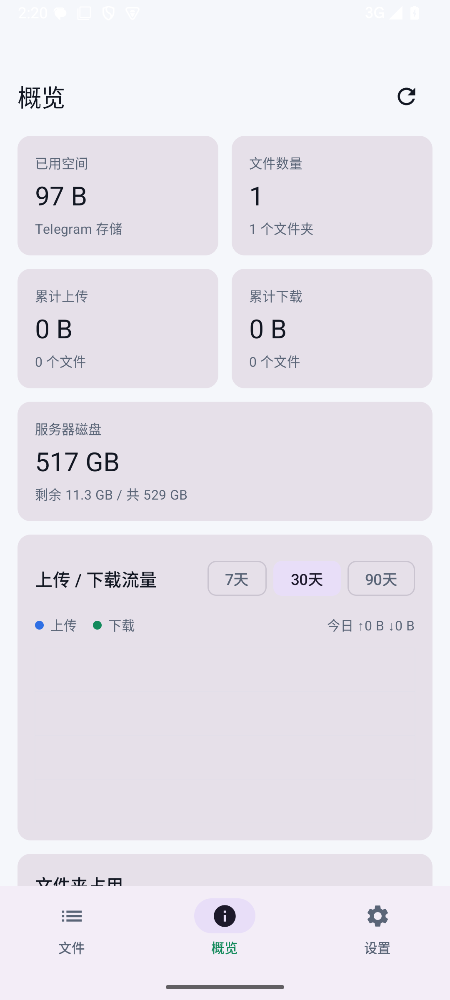

# HaoDrive Android（原生客户端）

Kotlin + Jetpack Compose 写的原生安卓客户端，直接连你自己的 HaoDrive 服务器。文件还是存在你的 Telegram 私有频道里，手机端走的是同一套 HTTP API。



## 已实现

- 登录：服务器地址（含密钥路径）+ 管理密码，Cookie 会话持久化
- 文件：文件夹切换、列表、搜索、下拉刷新/加载更多
- 上传：系统文件选择器，走**浏览器同款分片接口**（`/api/parts`），
  服务端一次只收一片，大文件自动拆片，带实时进度和片数显示
- 预览：图片、视频/音频走 Media3 (ExoPlayer)，HTTP Range 直接播放，
  跨分片由服务端拼接；PDF/文本提示下载
- 下载：流式写入用户选择的位置，带进度
- 文件操作：重命名、删除（同时删 Telegram 消息）
- 概览：**底部导航「概览」页**，指标是两列卡片方框（不是左侧导航栏）：
  已用空间、文件数、累计上传/下载、服务器磁盘、7/30/90 天流量图、文件夹占用
- 设置：服务器、Telegram 连接状态、退出登录、更换服务器

底部导航：文件 / 概览 / 设置，三个方框固定在屏幕下方。

## 构建

要求：JDK 17、Android SDK（compileSdk 37）、Gradle Wrapper 自带（Gradle 9.8.1）。

```bash
cd android
export JAVA_HOME=/path/to/jdk17
./gradlew assembleDebug          # 调试包
./gradlew assembleRelease        # 发布包（配置了签名才会签名）
```

产物：`android/app/build/outputs/apk/{debug,release}/`。

### 签名

`android/keystore.properties`（已被 .gitignore 排除）：

```properties
storeFile=../haodrive-release.jks
storePassword=你的口令
keyAlias=haodrive
keyPassword=你的口令
```

没有这个文件也能编译，只是 release 包未签名。

### 服务器地址

填完整地址，包括 Caddy 后面的密钥路径，例如：

```
https://你的域名:24443/你的密钥路径
```

## 说明

个人兴趣研究项目。把第三方即时通讯服务当存储后端**可能违反 Telegram 服务条款**，账号存在被限流、冻结、封禁的风险；重要数据请另做备份。详见 [../docs/RISK.md](../docs/RISK.md)。
